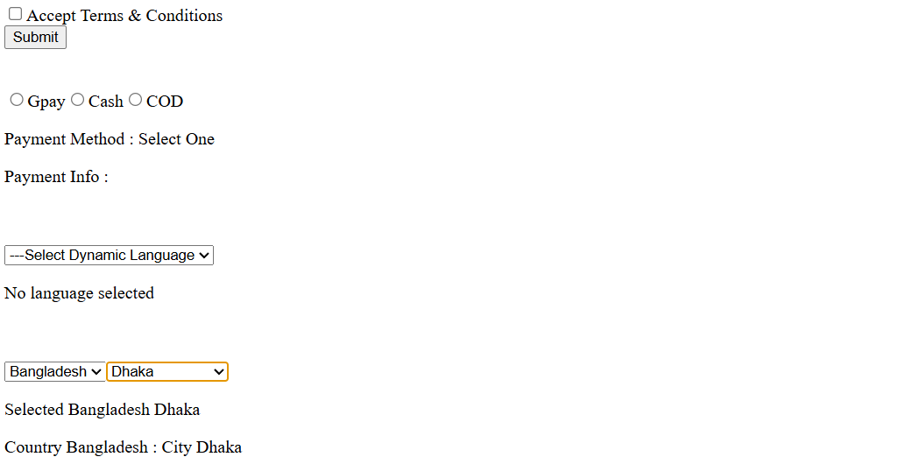

# React Form Handling Practice

## 📖 Overview
This repository contains my learning journey on **form handling in React**.  
I practiced how to manage user input using `useState`, handle events, and dynamically render dropdown options.

## 🎯 What I Learned
- Controlled components in React (`value` + `onChange`)
- Handling form inputs with `useState`
- Resetting state when parent selection changes (e.g., country → city)
- Dynamic dropdown creation using `map()`
- Cascading dropdowns (Country → City)